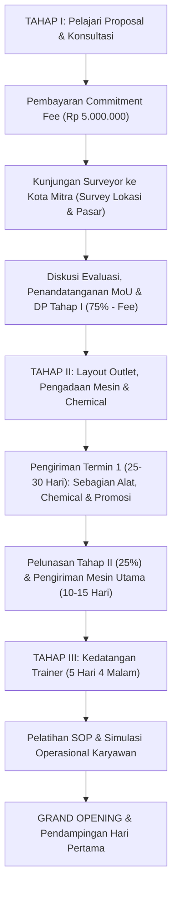

# PROPOSAL BUSINESS OPPORTUNITY — LAUNDRY CLEANIQUE
> **Sistem License Tanpa Royalty Fee — Keuntungan 100% Milik Anda**  
> Diterbitkan oleh: **PT Indotech Berkah Abadi**  
> Website: [www.peluangusahalaundry.com](http://www.peluangusahalaundry.com) | [www.bisnislaundrykiloan.com](http://www.bisnislaundrykiloan.com)

---

## DAFTAR ISI

1. [Pendahuluan](#1-pendahuluan)
2. [Manfaat Bermitra](#2-manfaat-bermitra)
3. [Pola Kemitraan](#3-pola-kemitraan)
4. [Perbandingan & Benefit Kemitraan (Lisensi vs Inisiasi)](#4-perbandingan--benefit-kemitraan-lisensi-vs-inisiasi)
5. [Benefit Unggulan Mitra](#5-benefit-unggulan-mitra)
6. [Syarat & Ketentuan Calon Mitra](#6-syarat--ketentuan-calon-mitra)
7. [Tahapan Kerjasama Kemitraan (SOP Pelaksanaan)](#7-tahapan-kerjasama-kemitraan-sop-pelaksanaan)
8. [Ketentuan Commitment Fee & Survey Lokasi](#8-ketentuan-commitment-fee--survey-lokasi)
9. [Lampiran Rincian Paket Kemitraan](#9-lampiran-rincian-paket-kemitraan)
   - [Paket Starter (45 Juta)](#91-paket-starter-rp-45000000-)
   - [Paket Super (75 Juta)](#92-paket-super-rp-75000000-)
   - [Paket Premium (167 Juta)](#93-paket-premium-rp-167000000-)
10. [Simulasi & Estimasi Anggaran Kemitraan](#10-simulasi--estimasi-anggaran-kemitraan)
11. [Catatan Penting Kerjasama](#11-catatan-penting-kerjasama)
12. [Kurikulum & Materi Pelatihan (Training)](#12-kurikulum--materi-pelatihan-training)
13. [Testimoni Mitra](#13-testimoni-mitra)
14. [Kontak & Rekening Resmi Pembayaran](#14-kontak--rekening-resmi-pembayaran)

---

## 1. PENDAHULUAN

Salam sukses, calon entrepreneur Indonesia!

Setiap orang mendambakan memiliki usaha mandiri yang mampu menjadi sumber nafkah utama dengan penghasilan yang tidak terbatas. Kebebasan finansial membuka peluang peningkatan kualitas hidup: pikiran yang tenang karena kebutuhan hidup tercukupi, waktu berkualitas bersama keluarga, serta kesiapan dana dan waktu untuk beribadah ke tanah suci.

### Analisis Potensi Industri Laundry:
* **Kebutuhan Primer Berulang:** Secara statistik sederhana, setiap individu mencuci rata-rata **2 hingga 4 potong pakaian per hari**.
* **Pangsa Pasar Luas & Stabil:** Kebutuhan jasa pencucian pakaian merupakan kebutuhan pokok yang permintaannya konsisten dan terus bertumbuh seiring urbanisasi dan gaya hidup modern.
* **Tingkat Risiko Rendah:** Arus kas harian tunai dengan risiko perputaran modal yang minim.

Proposal ini dirancang sebagai panduan komprehensif langkah demi langkah, mulai dari rincian *start-up*, analisis pasar, penataan operasional, hingga strategi pemasaran pemenang.

---

## 2. MANFAAT BERMITRA

Mitra yang bergabung bersama Cleanique Laundry mendapatkan fasilitas dan transfer wawasan profesional:
1. **Informasi Teruji & Terlengkap:** Seluruh rincian *start-up* bisnis laundry dipandu secara presisi tanpa ada yang disembunyikan.
2. **Riset Pasar & Analisis Kompetisi:** Wawasan riset pasar, pemetaan kompetitor, penentuan produk layanan, strategi penetapan harga (*pricing strategy*), dan pemilihan peralatan terbaik.
3. **Chemical Laundry Standar Pabrik:** Akses pasokan chemical terbaik, ramah lingkungan, berkualitas tinggi yang dapat menjadi sumber penghasilan tambahan (*extra income*).
4. **Desain Layout Interior Outlet Gratis:** Sketsa teknis penataan ruang dan alur kerja (*workflow*) outlet dengan garansi revisi sampai puas.
5. **Paket Desain Media Promosi Komplit:** Materi promosi siap cetak dan materi digital siap pakai untuk kebutuhan offline maupun online.
6. **Strategi Pemasaran Pemenang:** Formulasi teknik *digital marketing* dan *local marketing* terkini untuk memenangkan persaingan lokal.
7. **Dukungan Konsultasi Penuh:** Akses tanya jawab teknis operasional dan manajemen laundry tanpa batas waktu.

---

## 3. POLA KEMITRAAN

Cleanique Laundry menawarkan 2 (dua) opsi skema kemitraan yang fleksibel:

### A. Kemitraan Lisensi (Brand Laundry Cleanique)
* Mitra berhak menggunakan merek dagang resmi **Laundry Cleanique**.
* Mendapatkan dukungan penuh pada standarisasi SOP, kampanye pemasaran online/offline, media branding, suplai chemical standar pabrik, dan bimbingan berkala.
* Peluang bisnis tambahan sebagai **Agen Penjualan Produk Chemical Laundry Cleanique** di wilayah mitra.

### B. Kemitraan Inisiasi (Private Label / Merk Sendiri)
* Dirancang khusus bagi investor yang ingin membangun brand laundry dengan nama dan merek mandiri.
* Didampingi mulai dari fase persiapan tempat, instalasi mesin, pelatihan karyawan, hingga siap operasional (*grand opening*).
* Dilengkapi fasilitas penyiapan awal profil bisnis lokal (*Google My Business / Google Bisnisku*).

---

## 4. PERBANDINGAN & BENEFIT KEMITRAAN (LISENSI VS INISIASI)

| Parameter Kerjasama | Kemitraan Lisensi (Brand Cleanique) | Kemitraan Inisiasi (Merk Sendiri) |
| :--- | :--- | :--- |
| **Franchise Fee (Sewa Sistem)** | **Tidak ada (Rp 0)** | **Tidak ada (Rp 0)** |
| **Royalti Fee (Bagi Hasil Omzet)** | **Tidak ada (100% omzet milik mitra)** | **Tidak ada (100% omzet milik mitra)** |
| **License Fee (Sewa Merek)** | Rp 1,5 Juta/tahun (Minimal kontrak 5 tahun). Perpanjangan Rp 1 Juta/tahun | **Tidak ada (Rp 0)** |
| **Merek Dagang** | Laundry Cleanique (hak fasilitas & reputasi merk) | Merek Mandiri milik Mitra |
| **Durasi Kontrak** | Kontrak awal 5 tahun (dapat diperpanjang/diakhiri) | Berlaku s.d. outlet resmi buka (*Grand Opening*) |
| **Kewajiban Chemical** | **Wajib** memakai chemical resmi Laundry Cleanique | **Tidak Wajib** (bebas memilih chemical) |
| **Standar Kualitas Output** | - Lebih bersih, lembut, rapi, dan wangi konsisten - Formula aroma senada (deterjen, softener, pelicin, pewangi tidak tumpang tindih) | Menyesuaikan chemical yang dipilih mitra |
| **Fasilitas Website** | Dibuatkan 1 halaman profil khusus di website resmi Cleanique | Tidak ada |
| **Peremajaan Media Promo** | Peremajaan Akrilik Billboard, Neonbox, pricelist, kalender secara berkala (1 tahun sekali) | Sesuai isi paket awal (tanpa peremajaan gratis) |
| **Jangka Waktu Persiapan** | 35 – 45 hari kerja | 45 – 60 hari kerja |
| **Standar Operasional (SOP)** | Standar Baku Laundry Cleanique | Standar Umum Laundry |
| **Desain Promosi & Layout** | Standar Desain Laundry Cleanique | Desain standar mitra (dikenakan biaya tambahan) |
| **Penetapan Tarif Layanan** | Dapat diatur di atas harga rata-rata pasar (kualitas premium) | Menyesuaikan harga pasar lokal |
| **Dukungan Digital Marketing** | Website terindeks Google, Fanpage Facebook, FB Ads, Local Business (Google Maps), draft proposal kerjasama B2B | Setup awal Google My Business |

---

## 5. BENEFIT UNGGULAN MITRA

1. **Extra Income (Peluang Sub-Distributor Chemical):**  
   Mitra dapat menjadi penyuplai bahan baku chemical laundry resmi di wilayahnya. Penjualan ke laundry-laundry kompetitor di sekitar outlet menjadi sumber pendapatan tambahan yang menjanjikan.
2. **Harga Bahan Baku Lebih Hemat:**  
   Mitra resmi mendapatkan harga khusus chemical pabrik yang jauh lebih murah dibanding harga pasar ritel.
3. **Dukungan Aset Digital Siap Pakai:**  
   Promosi langsung melalui 6 Fanspage Facebook dengan ribuan pengikut aktif dan 2 portal website resmi industri laundry.
4. **Strategi Cepat Akuisisi Pelanggan:**
   - **Fanspage Facebook Usaha:** Halaman bisnis khusus yang dapat dikelola bersama mitra.
   - **Iklan Facebook Ads Tertarget:** Iklan berbayar dengan radius geografis presisi di sekitar radius outlet.
   - **Landing Page Khusus di Website:** Satu halaman promosi khusus berisi detail kontak dan promo outlet mitra.
   - **Optimasi Google Business Profile & Google Maps:** Integrasi lokasi fisik outlet agar mudah ditemukan di pencarian smartphone dan terhubung ke website.
   - **Kampanye Google Ads:** Jangkauan promosi berbasis kata kunci pencarian calon pelanggan terdekat.

---

## 6. SYARAT & KETENTUAN CALON MITRA

Calon mitra wajib memenuhi kriteria dasar kelayakan berikut:
1. Merupakan perseorangan, kelompok usaha, atau korporasi yang memiliki komitmen serius di industri jasa laundry.
2. Memiliki jiwa kewirausahaan, dedikasi, dan integritas bisnis.
3. Memiliki ketersediaan modal investasi paket serta dana cadangan modal kerja (*cash buffer*) operasional.
4. Bersedia melakukan proses rekrutmen karyawan secara teliti dan berkelanjutan.
5. Memahami karakteristik bisnis, potensi keuntungan, serta risiko operasional yang ada.
6. Menyediakan tempat usaha dengan luas ruangan yang memenuhi standar paket:
   - **Paket Starter:** Minimal 24 m²
   - **Paket Super:** Minimal 36 m²
   - **Paket Premium:** Minimal 72 m²
7. Lokasi usaha strategis:
   - Berada di pinggir jalan yang ramai dilalui lalu lintas warga/kendaraan umum.
   - Akses mudah dijangkau dan area parkir memadai.
   - Dekat kawasan hunian (perumahan, kos-kosan, apartemen) dan fasilitas umum.
8. Ketersediaan daya listrik minimal **2.200 Watt** (atau disesuaikan dengan akumulasi mesin yang beroperasi).
9. Sumber air bersih yang melimpah (PAM atau sumur bor beserta toren/penampung air) dan saluran pembuangan limbah laundry yang memadai.
10. Berperan aktif dalam pengawasan dan manajemen kemajuan usaha.

---

## 7. TAHAPAN KERJASAMA KEMITRAAN (SOP PELAKSANAAN)

### Rincian Pelaksanaan per Tahap:

### TAHAP I: Penjajakan, Survey Lokasi & Deal
1. **Penelaahan Proposal:** Calon mitra mengunduh, membaca, dan mempelajari keseluruhan proposal bisnis.
2. **Konsultasi Awal:** Diskusi kebutuhan teknis dan finansial bersama tim *Customer Care*.
3. **Pembayaran Commitment Fee:** Calon mitra menyetorkan *Commitment Fee* sebesar **Rp 5.000.000,-** (mengurangi total harga paket).
4. **Koordinasi Surveyor Lapangan:**
   - Mitra berkoordinasi langsung dengan surveyor mengenai jadwal dan tiket perjalanan.
   - Mitra menanggung transportasi 1 orang surveyor PP (tiket pesawat/kereta/travel + airport tax/bagasi/taksi).
   - Mitra menyediakan fasilitas penginapan dan makan surveyor selama di kota mitra (maksimal 3 hari 2 malam). Penginapan dapat menggunakan rumah pribadi yang bersih, nyaman, dan menjaga privasi.
5. **Pelaksanaan Survey:** Surveyor menganalisis kelayakan lokasi, ketersediaan daya listrik, sumber air, penataan pembuangan limbah, serta analisis kompetitor dan daya beli sekitar.
6. **Evaluasi & Deal Kerjasama:**
   - Diskusi hasil survey dan formulasi strategi outlet.
   - Penandatanganan nota kesepahaman (MoU).
   - Pembayaran Tahap I sebesar **75% dari nilai paket** (dikurangi Commitment Fee Rp 5.000.000,-) pada hari terakhir surveyor di lokasi.

### TAHAP II: Persiapan Layout, Produksi & Pengiriman Barang
1. Tim arsitektur dan teknis PT Indotech Berkah Abadi merancang denah tata letak (*layout*) mesin, pemipaan air & gas, instalasi kelistrikan, dan desain media promosi.
2. Mitra memulai proses rekrutmen calon staf/karyawan operasional.
3. **Pengiriman Termin 1 (Hari ke 25–30):** Pengiriman perlengkapan kerja, chemical laundry awal, dan media promosi (50%–75% dari paket), setelah setting fisik ruangan siap.
4. **Pelunasan Tahap II:** Mitra melakukan pelunasan sisa **25% dari nilai paket**.
5. **Pengiriman Termin 2 (Hari ke 10–15 berikutnya):** Pengiriman seluruh sisa paket mesin-mesin cuci, pengering komersial, dan perlengkapan utama lainnya.

### TAHAP III: Instalasi, Pelatihan (Training) & Grand Opening
1. Koordinasi keberangkatan Trainer ke kota mitra.
2. Mitra menanggung akomodasi dan konsumsi Trainer selama bertugas (5 hari 4 malam).
3. Penandatanganan perjanjian kerjasama definitif dan penyerahan buku panduan SOP resmi.
4. **Pelatihan Intensif:** Trainer memberikan pelatihan teknis dan manajemen kepada pemilik/supervisor dan seluruh karyawan sesuai SOP.
5. **Grand Opening:** Pembukaan resmi outlet dengan pendampingan langsung oleh Trainer di hari pertama, disertai pengiriman karangan bunga ucapan selamat dari PT Indotech Berkah Abadi.

---

## 8. KETENTUAN COMMITMENT FEE & SURVEY LOKASI

1. *Commitment Fee* disetorkan sebelum surveyor diberangkatkan ke lokasi usaha mitra.
2. Batas toleransi pembayaran selambat-lambatnya dilakukan saat surveyor tiba di kota mitra sebelum survey fisik dimulai, dengan menunjukkan bukti transfer resmi.
3. *Commitment Fee* bersifat memotong nilai paket kemitraan (mengurangi total kewajiban investasi).
4. **Kebijakan Pengembalian (Refund) jika Pembatalan dari Pihak Calon Mitra:**
   - **Kembali 100%:** Jika pihak Indotech belum melakukan persiapan keberangkatan survey.
   - **Kembali 50%:** Jika pihak Indotech telah mempersiapkan seluruh berkas dan administrasi keberangkatan survey.
   - **Kembali 25%:** Jika surveyor telah menyelesaikan survey lapangan namun belum dilakukan penandatanganan MoU.
   - **Tidak Dapat Dikembalikan (0%):** Jika pembatalan dilakukan setelah penandatanganan kesepakatan MoU oleh kedua belah pihak.
5. **Kebijakan Pembatalan dari Pihak Indotech Group:** Dana *Commitment Fee* dikembalikan penuh **100%**.

---

## 9. LAMPIRAN RINCIAN PAKET KEMITRAAN

Semua item peralatan dan perlengkapan dalam setiap paket adalah **100% BARU, BUKAN BARANG BEKAS, DAN BUKAN REKONDISI**.

---

### 9.1. PAKET STARTER (Rp 45.000.000,-)
* **Kebutuhan Ruangan:** Minimal 24 m²
* **Fasilitas Tambahan Termasuk:**
  - Pelatihan Manajemen Operasional Laundry Langsung di Lokasi
  - Dukungan Pemasaran Digital (*Marketing Online Support*)
  - Aplikasi Kasir Laundry Digital Selama 6 Bulan

#### A. Peralatan Utama Laundry
| No | Nama Produk / Mesin | Jumlah |
| :---: | :--- | :---: |
| 1 | Mesin Cuci Front Loading Kapasitas 7 kg | 1 Unit |
| 2 | Mesin Cuci Top Loading Kapasitas 9 kg | 1 Unit |
| 3 | Mesin Pengering Box Konversi Gas Kapasitas 10 kg | 1 Unit |
| 4 | Setrika Listrik | 2 Unit |
| 5 | Hair Dryer (Pengering Cepat Detailing) | 1 Unit |
| 6 | Timbangan Duduk Digital | 1 Unit |
| 7 | Timbangan Gantung Digital | 1 Unit |

#### B. Perlengkapan Operasional Laundry
| No | Item Perlengkapan | Jumlah | No | Item Perlengkapan | Jumlah |
| :---: | :--- | :---: | :---: | :--- | :---: |
| 1 | Kalkulator | 1 Unit | 22 | Plastik Packing Ukuran 7 kg | 2 Pack |
| 2 | Tag Gun | 2 Unit | 23 | Plastik Packing Ukuran 10 kg | 2 Pack |
| 3 | Tag Pin | 1 Box | 24 | Plastik Packing Ukuran 20 kg | 1 Pack |
| 4 | Jarum Tag Gun | 1 Box | 25 | Plastik Roll | 1 Roll |
| 5 | Staples + Isi | 2 Set | 26 | Kresek Ukuran Jumbo + Sablon | 2 Pack |
| 6 | Roller Selotip | 2 Unit | 27 | Kresek Ukuran Super Besar + Sablon | 2 Pack |
| 7 | Mini Cabinet | 1 Unit | 28 | Kanebo | 1 Unit |
| 8 | Busa Alas Setrika | 2 Pcs | 29 | Meteran | 1 Unit |
| 9 | Hanger | 2 Set | 30 | Sikat Cuci Pakaian | 1 Unit |
| 10 | Stempel Lunas / Outlet | 1 Unit | 31 | Sikat Gigi (Detailing Noda) | 1 Unit |
| 11 | Mika Tempat Brosur | 1 Unit | 32 | Mangkok Stainless Spotting | 2 Unit |
| 12 | Corong Takar Kecil | 1 Unit | 33 | Masker | 1 Pack |
| 13 | Wadah Chemical | 3 Unit | 34 | Buku SOP + Rekap Pembukuan | 1 Set |
| 14 | Tusuk Nota | 1 Unit | 35 | Buku Tulis Operasional | 1 Pcs |
| 15 | Sarung Tangan Plastik | 2 Pasang | 36 | Pulpen Standart | 2 Pcs |
| 16 | Keranjang Laundry | 8 Unit | 37 | Tipe-X | 1 Pcs |
| 17 | Botol Tester Kosong 25 ml | 4 Unit | 38 | Spidol OHP Permanen | 1 Pcs |
| 18 | Botol Tester Kosong 100 ml | 7 Unit | 39 | Kain Lap Microfiber | 1 Pcs |
| 19 | Pita Roll Tagging | 1 Roll | 40 | Sendok Takar Kimia | 2 Pcs |
| 20 | Selotip Bening | 1 Box | 41 | Botol Spray / Wadah 600 ml | 2 Pcs |
| 21 | Gunting | 1 Unit | | | |

#### C. Pasokan Chemical Laundry Awal
| No | Nama Produk Kimia Laundry | Jumlah / Volume | No | Nama Produk Kimia Laundry | Jumlah / Volume |
| :---: | :--- | :---: | :---: | :--- | :---: |
| 1 | Parfum Finishing Laundry ECO | 5 Liter | 13 | NAUKI (Sabun Khusus Lerak/Batik) | 1 Liter |
| 2 | Deterjen Cair ECO Premium | 5 Liter | 14 | Pembersih Tabung Mesin Cuci | 600 Gram |
| 3 | Softener ECO (Pelembut) | 1,5 Liter | 15 | Deterjen Helm | 1 Liter |
| 4 | Pelicin Setrika ECO | 1,5 Liter | 16 | Parfum Helm | 1 Liter |
| 5 | Chlorine Bleach (Pemutih Klorin) | 1 Liter | 17 | Pengkilap Body Helm / Motor | 1 Liter |
| 6 | Oxy Bleach (Pencerah Warna) | 1 Kg | 18 | Deterjen Khusus Karpet | 1 Liter |
| 7 | Anti Noda Bandel | 1 Liter | 19 | Riyadh (Parfum Karpet) 250 ml | 2 Botol |
| 8 | Anti Noda Darah | 1 Liter | 20 | Paket Bahan Softener (DeterMat) | 1 Box |
| 9 | Anti Noda Karat | 1 Liter | 21 | Paket Bahan Softsanse | 1 Box |
| 10 | Anti Noda Tinta | 1 Liter | 22 | Paket Bahan Parfum Waterbase (Essenz) | 1 Box |
| 11 | Anti Noda Lemak & Minyak | 600 ml | 23 | Parfum Karpet (Alkohol Base) | 1 Liter |
| 12 | Anti Noda Jamur | 0,5 Kg | | | |

#### D. Paket Media Promosi & Digital Marketing
* **Materi Promosi Fisik (Offline):**
  1. Akrilik Billboard Identitas Outlet (1 Pcs)
  2. Standing X-Banner (2 Pcs)
  3. Brosur Promosi Full Color (2 Rim)
  4. Rotex Promosi (5 Pcs)
  5. Mini X-Banner Pricelist Meja (1 Pcs)
  6. Nota Transaksi NCR Rangkap (1 Rim)
  7. Kartu Nama Bisnis Laundry (1 Box)
  8. Kartu Member Pelanggan (10 Pcs)
  9. Kalender Dinding Merchandise (1 Pcs)
  10. Flyer Voucher Diskon / Promo (50 Pcs)
  11. Sticker Branding Meja Front Office (1 Pcs)
  12. Poster Syarat & Ketentuan Layanan (1 Pcs)
  13. Akrilik Neon Box Menyala (1 Pasang)
* **Digital Marketing Setup:**
  1. Registrasi & Verifikasi Google My Business (Google Maps)
  2. Pembuatan & Konfigurasi Fanspage Bisnis Facebook

---

### 9.2. PAKET SUPER (Rp 75.000.000,-)
* **Kebutuhan Ruangan:** Minimal 36 m²
* **Fasilitas Tambahan Termasuk:**
  - Pelatihan Manajemen Operasional Laundry Komplit di Lokasi
  - **Voucher Belanja Chemical Senilai Rp 300.000,-**
  - Dukungan Pemasaran Digital (*Marketing Online Support*)
  - **Aplikasi Kasir POS Laundry Cleanique Lisensi Penuh Selama 1 Tahun**

#### A. Peralatan Utama Laundry
| No | Nama Produk / Mesin | Jumlah |
| :---: | :--- | :---: |
| 1 | Mesin Cuci Front Loading Kapasitas 7 kg | 2 Unit |
| 2 | Mesin Cuci Top Loading Kapasitas 12 kg (Heavy Duty) | 1 Unit |
| 3 | Mesin Pengering Box Konversi Gas Kapasitas 10 kg | 2 Unit |
| 4 | Setrika Listrik | 1 Unit |
| 5 | **Setrika Uap Boiler Gas Kapasitas 15 Liter** | 1 Unit |
| 6 | Hair Dryer | 1 Unit |
| 7 | **Vertical Steamer (Dry Cleaning & Jas)** | 1 Unit |
| 8 | Timbangan Duduk Digital Presisi | 1 Unit |
| 9 | Timbangan Gantung Digital | 1 Unit |
| 10 | **Tablet Android Khusus Kasir POS** | 1 Unit |
| 11 | **Software / Aplikasi Kasir Manajemen Laundry** | 1 Unit |

#### B. Perlengkapan Operasional Laundry
| No | Item Perlengkapan | Jumlah | No | Item Perlengkapan | Jumlah |
| :---: | :--- | :---: | :---: | :--- | :---: |
| 1 | Kalkulator | 1 Unit | 22 | Plastik Packing Ukuran 7 kg | 1 Pack |
| 2 | Tag Gun | 2 Unit | 23 | Plastik Packing Ukuran 10 kg | 2 Pack |
| 3 | Tag Pin | 1 Box | 24 | Plastik Packing Ukuran 20 kg | 1 Pack |
| 4 | Jarum Tag Gun | 1 Box | 25 | Plastik Roll | 1 Roll |
| 5 | Staples + Isi | 2 Set | 26 | Kresek Ukuran Jumbo + Sablon | 2 Pack |
| 6 | Roller Selotip | 2 Unit | 27 | Kresek Ukuran Super Besar + Sablon | 2 Pack |
| 7 | Mini Cabinet | 1 Unit | 28 | Kanebo | 1 Unit |
| 8 | Busa Alas Setrika Tebal | 2 Pcs | 29 | Meteran | 1 Unit |
| 9 | Hanger Pakaian | 2 Set | 30 | Sikat Cuci Pakaian | 1 Unit |
| 10 | Stempel Outlet | 1 Unit | 31 | Sikat Gigi Detailing | 2 Unit |
| 11 | Mika Brosur Meja | 1 Unit | 32 | Mangkok Stainless Spotting | 2 Unit |
| 12 | Corong Takar | 1 Unit | 33 | Masker Pelindung | 1 Pack |
| 13 | Wadah Jerigen Chemical | 4 Unit | 34 | Buku SOP + Rekap Administrasi | 1 Set |
| 14 | Tusuk Nota | 1 Unit | 35 | Buku Tulis Operasional | 1 Pcs |
| 15 | Sarung Tangan Plastik | 2 Pasang | 36 | Pulpen Standart | 2 Pcs |
| 16 | Keranjang Laundry Kapasitas Besar | 10 Unit | 37 | Tipe-X | 1 Pcs |
| 17 | Botol Tester Aroma 25 ml | 5 Unit | 38 | Spidol OHP | 1 Pcs |
| 18 | Botol Tester Aroma 100 ml | 7 Unit | 39 | Kain Lap Pembersih | 1 Pcs |
| 19 | Pita Roll Label | 1 Roll | 40 | Sendok Takar | 2 Pcs |
| 20 | Selotip Bening | 1 Box | 41 | Botol Spray 600 ml | 2 Pcs |
| 21 | Gunting Tajam | 1 Unit | | | |

#### C. Pasokan Chemical Laundry Awal
| No | Nama Produk Kimia Laundry | Jumlah / Volume | No | Nama Produk Kimia Laundry | Jumlah / Volume |
| :---: | :--- | :---: | :---: | :--- | :---: |
| 1 | Parfum Finishing Laundry ECO | 5 Liter | 14 | Pembersih Tabung Mesin Cuci | 600 Gram |
| 2 | Deterjen Cair ECO Premium | 5 Liter | 15 | Deterjen Helm | 1 Liter |
| 3 | Softener ECO (Pelembut Serat) | 5 Liter | 16 | Parfum Helm | 1 Liter |
| 4 | Pelicin Setrika ECO | 5 Liter | 17 | Pengkilap Body Helm / Motor | 1 Liter |
| 5 | Chlorine Bleach | 2 Liter | 18 | Deterjen Khusus Karpet | 1 Liter |
| 6 | Oxy Bleach Bubuk Pencerah | 1 Kg | 19 | Riyadh (Parfum Karpet) 250 ml | 3 Botol |
| 7 | Anti Noda Bandel Serbaguna | 1 Liter | 20 | Paket Bahan Softener (DeterMat) | 2 Box |
| 8 | Anti Noda Darah | 1 Liter | 21 | Paket Bahan Softsanse | 2 Box |
| 9 | Anti Noda Karat | 1 Liter | 22 | Paket Bahan Parfum Waterbase (Essenz) | 2 Box |
| 10 | Anti Noda Tinta | 1 Liter | 23 | Parfum Karpet (Alkohol Base) | 1 Liter |
| 11 | Anti Noda Lemak & Minyak | 1 Liter | 24 | **Pembersih Kaca Khusus** | 1 Liter |
| 12 | Anti Noda Jamur | 1 Liter | 25 | **Green Solvent (Dry Cleaning)** | 2 Liter |
| 13 | NAUKI (Lerak Khusus Batik/Sutra) | 1 Liter | | | |

#### D. Paket Media Promosi & Digital Marketing
* **Materi Promosi Fisik (Offline):**
  1. Akrilik Billboard Identitas Outlet (1 Pcs)
  2. Standing X-Banner (2 Pcs)
  3. Brosur Promosi Warna (2 Rim)
  4. Rotex Promosi (10 Pcs)
  5. Mini X-Banner Pricelist Meja (1 Pcs)
  6. Nota Transaksi Rangkap (1 Rim)
  7. Kartu Nama Bisnis (1 Box)
  8. Kartu Member Eksklusif (10 Pcs)
  9. Kalender Merchandise (1 Pcs)
  10. Flyer Voucher Gratis Cuci (50 Pcs)
  11. Sticker Meja Front Office (1 Pcs)
  12. Poster Ketentuan Layanan (1 Pcs)
  13. Akrilik Neon Box Menyala (1 Pasang)
  14. **Laundry Bag Eksklusif Sablon (50 Pcs)**
  15. **Stiker Branding Backdoor / Rak Display (1 Pcs)**
  16. **Seragam Karyawan Resmi Cleanique (3 Pcs)**
* **Digital Marketing Setup:**
  1. Setup Profil Google My Business & Maps
  2. Setup Halaman Bisnis Facebook
  3. Riset Kata Kunci Lokal Google (*Keyword Research*)
  4. Pengaturan Kampanye Iklan Facebook Marketplace

---

### 9.3. PAKET PREMIUM (Rp 167.000.000,-)
* **Kebutuhan Ruangan:** Minimal 72 m² (Skala Usaha Komersial Besar)
* **Fasilitas Tambahan Termasuk:**
  - Pelatihan Komprehensif Manajemen & Operasional Langsung di Lokasi
  - **Voucher Belanja Chemical Senilai Rp 500.000,-**
  - Dukungan Promosi Online Skala Penuh
  - **Aplikasi Kasir POS Manajemen Laundry Cleanique Selama 1,5 Tahun**

#### A. Peralatan Utama Laundry
| No | Nama Produk / Mesin | Jumlah |
| :---: | :--- | :---: |
| 1 | Mesin Cuci Front Loading Kapasitas 7 kg | 4 Unit |
| 2 | Mesin Cuci Top Loading Kapasitas 12 kg | 2 Unit |
| 3 | Mesin Pengering Box Konversi Gas Kapasitas 10 kg | 2 Unit |
| 4 | Setrika Listrik | 2 Unit |
| 5 | **Setrika Uap Boiler Gas Kapasitas 20 Liter (Kapasitas Besar)** | 2 Unit |
| 6 | Hair Dryer | 1 Unit |
| 7 | Vertical Steamer Dry Clean | 1 Unit |
| 8 | Timbangan Duduk Digital | 1 Unit |
| 9 | Timbangan Gantung Digital | 1 Unit |
| 10 | Tablet Android Kasir | 1 Unit |
| 11 | Software Aplikasi Manajemen Laundry | 1 Unit |
| 12 | **Mesin Pengering Gas Tambahan Kapasitas 10 kg** | 2 Unit |
| 13 | **Vacuum Cleaner Heavy Duty (Pembersih Karpet & Interior)** | 1 Unit |
| 14 | **Perangkat Komputer PC Lengkap + Printer Nota Kasir** | 1 Set |

#### B. Perlengkapan Operasional Laundry
| No | Item Perlengkapan | Jumlah | No | Item Perlengkapan | Jumlah |
| :---: | :--- | :---: | :---: | :--- | :---: |
| 1 | Kalkulator | 1 Unit | 22 | Plastik Packing Ukuran 7 kg | 5 Pack |
| 2 | Tag Gun | 3 Unit | 23 | Plastik Packing Ukuran 10 kg | 5 Pack |
| 3 | Tag Pin | 2 Box | 24 | Plastik Packing Ukuran 20 kg | 4 Pack |
| 4 | Jarum Tag Gun | 1 Box | 25 | Plastik Roll | 1 Roll |
| 5 | Staples + Isi | 2 Set | 26 | Kresek Ukuran Jumbo + Sablon | 5 Pack |
| 6 | Roller Selotip | 3 Unit | 27 | Kresek Ukuran Super Besar + Sablon | 5 Pack |
| 7 | Mini Cabinet | 1 Unit | 28 | Kanebo | 1 Unit |
| 8 | Busa Alas Setrika | 3 Pcs | 29 | Meteran | 1 Unit |
| 9 | Hanger Pakaian | 10 Pack | 30 | Sikat Cuci Pakaian | 2 Unit |
| 10 | Stempel Outlet | 1 Unit | 31 | Sikat Gigi Detailing | 1 Unit |
| 11 | Mika Brosur Meja | 1 Unit | 32 | Mangkok Stainless Spotting | 4 Unit |
| 12 | Corong Takar | 1 Unit | 33 | Masker | 1 Pack |
| 13 | Wadah Jerigen Chemical | 4 Unit | 34 | Buku SOP + Rekap Akuntansi | 1 Set |
| 14 | Tusuk Nota | 1 Unit | 35 | Buku Tulis Operasional | 2 Pcs |
| 15 | Sarung Tangan Plastik | 4 Pasang | 36 | Pulpen Standart | 3 Pcs |
| 16 | Keranjang Laundry Besar | 20 Unit | 37 | Tipe-X | 2 Pcs |
| 17 | Botol Tester Aroma 25 ml | 6 Unit | 38 | Spidol OHP | 2 Pcs |
| 18 | Botol Tester Aroma 100 ml | 10 Unit | 39 | Kain Lap Pembersih | 2 Pcs |
| 19 | Pita Roll Label | 2 Roll | 40 | Sendok Takar | 3 Pcs |
| 20 | Selotip Bening | 2 Box | 41 | Botol Spray 600 ml | 2 Pcs |
| 21 | Gunting | 2 Unit | 42 | **Plastik Pelindung Hanger / Jas** | 3 Pack |

#### C. Pasokan Chemical Laundry Awal
| No | Nama Produk Kimia Laundry | Jumlah / Volume | No | Nama Produk Kimia Laundry | Jumlah / Volume |
| :---: | :--- | :---: | :---: | :--- | :---: |
| 1 | Parfum Finishing Laundry ECO | 5 Liter | 14 | Pembersih Tabung Mesin Cuci | 3 Kg |
| 2 | Deterjen Cair ECO | 5 Liter | 15 | Deterjen Helm | 3 Liter |
| 3 | Softener ECO | 5 Liter | 16 | Parfum Helm | 3 Liter |
| 4 | Pelicin Setrika ECO | 10 Liter | 17 | Pengkilap Helm | 3 Liter |
| 5 | Chlorine Bleach | 5 Liter | 18 | Deterjen Khusus Karpet | 3 Liter |
| 6 | Oxy Bleach Bubuk | 5 Kg | 19 | Riyadh (Parfum Karpet) 250 ml | 4 Botol |
| 7 | Anti Noda Bandel | 2 Liter | 20 | Paket Bahan Softener (DeterMat) | 3 Box |
| 8 | Anti Noda Darah | 2 Liter | 21 | Paket Bahan Softsanse | 3 Box |
| 9 | Anti Noda Karat | 2 Liter | 22 | Paket Bahan Parfum Waterbase (Essenz) | 3 Box |
| 10 | Anti Noda Tinta | 2 Liter | 23 | Parfum Karpet (Alkohol Base) | 3 Liter |
| 11 | Anti Noda Lemak & Minyak | 2 Liter | 24 | Pembersih Kaca | 3 Liter |
| 12 | Anti Noda Jamur | 2 Liter | 25 | Green Solvent Dry Clean | 2 Liter |
| 13 | NAUKI (Lerak Batik Alami) | 3 Liter | | | |

#### D. Paket Media Promosi & Digital Marketing
* **Materi Promosi Fisik (Offline):**
  1. Akrilik Billboard Identitas Outlet (1 Pcs)
  2. Standing X-Banner (2 Pcs)
  3. Brosur Promosi (2 Rim)
  4. Rotex Promosi (10 Pcs)
  5. Mini X-Banner Pricelist Meja (1 Pcs)
  6. Nota Transaksi NCR Rangkap (1 Rim)
  7. Kartu Nama Bisnis (1 Box)
  8. Kartu Member Eksklusif (10 Pcs)
  9. Kalender Merchandise (1 Pcs)
  10. Flyer Voucher Diskon (50 Pcs)
  11. Sticker Meja Front Office (1 Pcs)
  12. Poster Syarat & Ketentuan Layanan (1 Pcs)
  13. Akrilik Neon Box Menyala (1 Pasang)
  14. **Laundry Bag Jumbo Eksklusif Sablon (100 Pcs)**
  15. **Stiker Branding Backdoor / Rak Display (1 Pcs)**
  16. **Seragam Kerja Karyawan Resmi Cleanique (6 Pcs)**
* **Digital Marketing Komprehensif:**
  1. Setup Profil Google My Business & Titik Google Maps
  2. Setup Fanspage Bisnis Facebook Resmi
  3. Riset Kata Kunci Pencarian Google (*Google Keyword Research*)
  4. Kampanye Iklan Facebook Marketplace
  5. **Riset Target Pemirsa Iklan Facebook (*Audience Research FB Ads*)**
  6. **Pengaturan Kampanye Iklan Berbayar Google Ads (*AdWords Campaign*)**

---

## 10. SIMULASI & ESTIMASI ANGGARAN KEMITRAAN

Berikut adalah contoh rincian alur pembayaran dan estimasi anggaran total yang disetorkan ke PT Indotech Berkah Abadi untuk **Paket Starter (Rp 45.000.000,-)** di wilayah **Jabodetabek dan sekitarnya**:

| No | Tahapan Item Pembayaran | Estimasi Dana Anggaran | Keterangan & Jadwal Pembayaran |
| :---: | :--- | :---: | :--- |
| 1 | **Commitment Fee** | Rp 5.000.000,- | Dibayarkan sebelum survey lokasi (mengurangi harga paket) |
| 2 | **Transportasi Surveyor** (Pesawat/Kereta/Travel PP) | Rp 1.700.000,- | Estimasi tiket & transportasi lokal surveyor |
| 3 | **Akomodasi Surveyor** (Penginapan & Makan 3H 2M) | Rp 800.000,- | Dapat efisien jika mitra menyediakan tempat inap layak |
| 4 | **Pembayaran Tahap I** (75% x Rp 45 Jt - Fee) | Rp 28.750.000,- | Disetorkan saat deal MoU pada hari terakhir survey |
| 5 | **Pembayaran Tahap II / Pelunasan** (25% x Rp 45 Jt) | Rp 11.250.000,- | Disetorkan saat termin barang pertama telah tiba |
| 6 | **Transportasi Trainer** (Pesawat/Kereta/Travel PP) | Rp 1.700.000,- | Estimasi transportasi trainer menuju kota mitra |
| 7 | **Akomodasi Trainer** (Penginapan & Makan 5H 4M) | Rp 1.650.000,- | Operasional dan penginapan trainer selama masa training |
| 8 | **Biaya Ongkos Kirim Ekspedisi Logistik** | Rp 1.500.000,- | Pengiriman seluruh mesin, chemical, dan media promo |
| **TOTAL** | **Estimasi Total Setoran ke Indotech** | **Rp 52.350.000,-** | *(Estimasi batas maksimal)* |

> [!NOTE]
> * Angka pengeluaran transportasi dan akomodasi di atas merupakan **estimasi pagu maksimal**. Mitra berhak menjemput sendiri atau menyediakan penginapan pribadi yang layak untuk menghemat biaya.
> * **Biaya di Luar Paket yang Perlu Disiapkan Mitra:** Sewa ruko/tempat usaha, renovasi sipil bangunan, upah tukang, instalasi kelistrikan & pemipaan air/gas, sambungan internet & telepon, pendingin ruangan (AC), serta furnitur pendukung (meja kasir, kursi tunggu, rak susun pakaian).

---

## 11. CATATAN PENTING KERJASAMA

1. **Jaminan Kualitas Barang:** Semua peralatan, mesin cuci, mesin pengering, dan instrumen operasional adalah **100% BARU**, bukan barang bekas (*second*), dan bukan barang rekondisi.
2. **Kebebasan Memilih Identitas:** Mitra memiliki hak prerogatif penuh untuk memilih apakah ingin menggunakan lisensi resmi **Laundry Cleanique** atau merek mandiri (**Inisiasi**).
3. **Fleksibilitas Paket (Custom Upgrade):** Komposisi paket di atas merupakan acuan standar. Mitra diperbolehkan menambah kapasitas mesin, meng-upgrade spesifikasi mesin cuci/pengering, menambah setrika uap boiler, atau menambah unit komputer kasir sesuai ketersediaan anggaran.
4. **Penyesuaian Teknis Lapangan:** Hal-hal detail menyangkut instalasi pemipaan, kebutuhan daya listrik tambahan, dan tata letak interior disesuaikan bersama surveyor saat visitasi lokasi.
5. **Kemudahan Setoran Commitment Fee:** Demi kenyamanan dan kepercayaan calon mitra, *Commitment Fee* dapat diserahkan saat surveyor tiba di lokasi (wajib diselesaikan sebelum survei teknis dilakukan). Pemesanan tiket transportasi surveyor dapat dipesan langsung oleh calon mitra atas nama surveyor.
6. **Verifikasi Kredibilitas Resmi:** Calon mitra dapat memverifikasi rekam jejak, portofolio, dan legalitas PT Indotech Berkah Abadi melalui website resmi [www.peluangusahalaundry.com](http://www.peluangusahalaundry.com), [www.bisnislaundrykiloan.com](http://www.bisnislaundrykiloan.com), atau mengunjungi showroom dan outlet mitra Cleanique di berbagai kota di Indonesia.

---

## 12. KURIKULUM & MATERI PELATIHAN (TRAINING)

Trainer profesional akan mendampingi mitra dan karyawan secara langsung di outlet selama 5 hari mencakup 3 (tiga) pilar utama:

### 1. Pelatihan Prosedur & Operasional Teknis Laundry
Mencakup siklus kerja lengkap cucian dari masuk hingga siap diambil pelanggan:
* **a. Pencatatan Data & Nota:** Pemeriksaan kondisi awal pakaian, pencatatan jumlah potong, dan identifikasi instruksi khusus konsumen.
* **b. Tagging (Labeling Identitas):** Teknik pemasangan pita label anti luntur untuk mencegah risiko pakaian tertukar atau hilang.
* **c. Spotting (Penanganan Noda Khusus):** Identifikasi jenis noda (darah, karat, tinta, lemak, jamur, minyak) dan teknik pembersihan manual sebelum dicuci mesin.
* **d. Washing (Proses Cuci Mesin):** Formula dosis deterjen cair, rasio beban mesin front-loading/top-loading, dan manajemen waktu siklus pencucian.
* **e. Smoothing (Pelembut Kain):** Takaran softener untuk menjaga kelembutan serat pakaian dan efisiensi air bilasan.
* **f. Drying (Pengeringan Mesin):** Pengoperasian dryer konversi gas, pengaturan temperatur kain sensitif, dan standar keamanan tabung LPG.
* **g. Ironing (Penyetrikaan Uap & Listrik):** Standar pelipatan presisi, teknik setrika uap boiler bertekanan tinggi, dan penggunaan cairan pelicin setrika.
* **h. Packing & Perfuming:** Prosedur penyemprotan parfum finishing laundry grade terbaik dan teknik packing plastik kedap udara yang rapi.
* **i. Dry Cleaning:** Standar operasional pencucian kering untuk pakaian khusus (jas, kebaya, gaun pesta, pakaian berbahan sutra/wol).

### 2. Pelatihan Manajemen & Administrasi Bisnis
* **a. Pengelolaan Nota & Alur Kasir:** Prosedur penerimaan pembayaran tunai, transfer, dan uang kembalian.
* **b. Pembukuan Kas Harian:** Pencatatan omzet harian, kas kecil (*petty cash*), dan pengeluaran harian.
* **c. Laporan Keuangan Bulanan:** Rekonsiliasi laba rugi bulanan dan monitoring margin profit kotor/bersih.
* **d. Pengoperasian Software Kasir POS:** Input transaksi, pengiriman nota digital via WhatsApp, dan monitoring pesanan.
* **e. Manajemen Stock Opname:** Kontrol inventaris chemical, plastik packing, gas LPG, dan pencegahan pemborosan material (*waste control*).
* **f. Quality Control (QC):** Standar pemeriksaan akhir sebelum pakaian diserahkan ke pelanggan (kebersihan noda, keharuman, kerapian lipatan).

### 3. Pelatihan Strategi Marketing & Promosi Lokal
* **a. Distribusi Flyer & Brosur:** Teknik penyebaran brosur terarah ke perumahan, indekos, perkantoran, dan pusat aktivitas warga.
* **b. Pembentukan Jaringan Keagenan:** Membangun *drop point* / agen titip cucian di warung atau toko sekitar untuk memperluas jangkauan pasar.
* **c. Program Promo Diskon Pembukaan:** Strategi diskon *grand opening* untuk memicu antrean pelanggan pertama.
* **d. Door Prize & Program Loyalitas:** Event undian berhadiah untuk meningkatkan retensi konsumen.
* **e. Kartu Member & Paket Berlangganan:** Penjualan paket deposit cuci kiloan di muka (*cash-in advance*).
* **f. Pengelolaan Konten Media Sosial:** Panduan posting berkala, interaksi komunitas, dan promosi berkala di Facebook/Instagram.
* **g. Optimalisasi Google My Business:** Mengumpulkan ulasan bintang 5 (*Google Review*) dari pelanggan puas agar outlet mendominasi pencarian lokal.

---

## 13. TESTIMONI MITRA

> *"Selamat siang, produk-produk Laundry Cleanique Luar Biasa. Saya sebagai customer sangat terbantu dan senang karena produk-produknya terjaga kualitasnya, sehingga hasil yang didapatkan juga tetap sama dan tidak mengecewakan. Terima kasih."*  
> **— Pak Iwan (Mitra Laundry Cleanique Purwokerto)**

> *"Di tengah menjamurnya usaha Chemical Laundry bak jamur di musim hujan, Laundry Cleanique tetap exist dengan menjaga kwalitasnya, keep hamasah, tetap semangat Makasar BISA."*  
> **— Pak Ismail (Deputi Chemical Laundry Cleanique Makassar)**

---

## 14. KONTAK & REKENING RESMI PEMBAYARAN

### Legalitas & Kantor Pusat:
* **Perusahaan:** PT Indotech Berkah Abadi
* **Alamat Kantor & Showroom:**  
  Jongke Tengah No. 30, Mlati, Kabupaten Sleman, Daerah Istimewa Yogyakarta 55285
* **Telepon Kantor:** (0274) 2882482
* **Hotline / Konsultasi WhatsApp:** **0856-0006-1005 (Ragil)**
* **Official Website:**  
  - [www.peluangusahalaundry.com](http://www.peluangusahalaundry.com)
  - [www.bisnislaundrykiloan.com](http://www.bisnislaundrykiloan.com)

---

### Rekening Resmi Pembayaran:
> [!IMPORTANT]
> Seluruh transaksi pembayaran resmi (Commitment Fee, Pelunasan Paket, maupun Pembelian Chemical) **HANYA** ditransfer ke rekening resmi perusahaan atas nama **PT. Indotech Berkah Abadi** atau **Yudi Saputra**:

| Nama Bank | Nomor Rekening | Atas Nama Pemilik Rekening |
| :---: | :---: | :--- |
|  **Bank BNI** | **0109648948** | PT. Indotech Berkah Abadi / Yudi Saputra |
|  **Bank BRI** | **203301004058501** | PT. Indotech Berkah Abadi / Yudi Saputra |
|  **Bank BCA** | **0372507975** | PT. Indotech Berkah Abadi / Yudi Saputra |
|  **Bank Mandiri** | **1370005029661** | PT. Indotech Berkah Abadi / Yudi Saputra |
