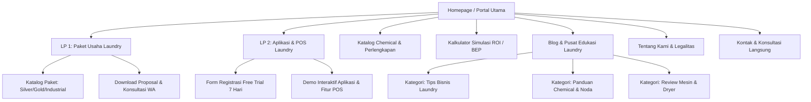

# Cleanique Laundry — Official WordPress Custom Theme & Web Platform
> **Solusi Ekosistem Bisnis & Digitalisasi Laundry Modern Indonesia**  
> Produk Resmi dari **PT Indotech Berkah Abadi** ([indotech.id](https://indotech.id))

---

## 📌 Ringkasan Eksekutif (Project Overview)

**Cleanique Laundry** adalah lini produk dan ekosistem bisnis terpadu di bawah naungan **PT Indotech Berkah Abadi** (produsen chemical industri, home care *Orchid Brand*, dan penyedia paket usaha laundry terkemuka asal Sleman, D.I. Yogyakarta).

Platform web ini dibangun di atas WordPress menggunakan **Custom Theme Mandiri (Cleanique Theme)** yang dirancang dengan pendekatan *high-performance, zero-bloat, SEO-first*, dan *high-converting UI/UX*.

### Dua Pilar Model Bisnis Utama:
1. **Paket Usaha Laundry (Turnkey Physical Business):** Paket kemitraan siap buka (mesin cuci & dryer komersial, chemical laundry pabrikan sendiri, instalasi, perlengkapan, hingga pelatihan SOP bisnis).
2. **Aplikasi / Sistem Informasi Laundry Digital (SaaS Digital Product):** Software manajemen & kasir POS laundry cerdas berbasis cloud, nota digital otomatis WhatsApp, pelacakan status cucian live pelanggan, laporan omzet real-time, harga sangat terjangkau (**murah meriah**) dengan **Free Trial 7 Hari Pertama Gratis Tanpa Syarat**.

---

## 🏗️ Metodologi Pengembangan (The Matt Pocock Slice & Spec Methodology)

Mengadopsi pola rekayasa perangkat lunak berbasis spesifikasi terstruktur (*Spec-Driven Development*):
1. **Clear Boundaries & Separation of Concerns:** Memisahkan logika presentasi (PHP templates), styling (CSS tokens & utility classes), script interaktif (vanilla JS mikro-interaksi), dan data layer (Custom Post Types, ACF / Custom Meta Boxes).
2. **Vertical Slice Architecture:** Membangun per fitur secara tuntas (Spec -> Layout -> Data Field -> Form / WA CTA -> Analytics Tracking) sehingga setiap halaman dapat diuji dan menghasilkan konversi secara mandiri.
3. **Developer Experience (DX) & Clean Code:** Kode modular, penamaan semantik BEM / utility token, tanpa ketergantungan plugin builder yang berat (Elementor/Divi bloat-free), menghasilkan PageSpeed 95+ di mobile & desktop.

---

## 🗺️ Arsitektur Halaman & Struktur Sitemap (Full Page Structure)

Berikut adalah hierarki dan rancangan halaman yang telah dipetakan:



### 1. 🚀 Landing Page 1: Paket Usaha Laundry (`/paket-usaha-laundry/`)
*Fokus: Konversi calon investor, pemula bisnis laundry, dan pensiunan/wirausaha baru.*
- **Target Audience:** Individu yang ingin memulai usaha laundry kiloan/satuan dengan modal terukur tanpa risiko coba-coba.
- **Hero Section:** Headline kuat, sub-headline persuasif, badge garansi & pabrikan resmi PT Indotech Berkah Abadi, CTA utama: *"Konsultasi Paket Usaha Gratis via WhatsApp"* & *"Download Brosur & Rincian Modal"*.
- **Problem & Solution Matrix:** Risiko buka laundry sendirian (salah pilih mesin, formula deterjen boros, tidak ada SOP) vs Solusi All-in-One Cleanique.
- **Pilihan Paket Usaha:**
  - *Paket Starter / Rumahan (Kiloan Fresh)*: Modal terjangkau, mesin washer-dryer kompak, paket chemical awal, spanduk, SOP.
  - *Paket Commercial Pro (Kiloan & Bed Cover)*: Mesin komersial stack heavy duty, boiler uap, chemical lengkap Orchid Brand, rak display, sistem kasir.
  - *Paket Industrial / Premium Outlet*: Kapasitas besar, multi-dryer gas, packaging machine, chemical premium, pendampingan grand opening onsite.
- **Rincian Apa yang Didapatkan Mitra:**
  - Mesin Cuci & Mesin Pengering Bergaransi Resmi.
  - Pasokan Bahan Kimia (*Chemical*) langsung dari pabrik Indotech (Parfum, Deterjen Anti-Apek, Softener, Pembersih Noda Darah/Minyak/Karat).
  - Instalasi Pipa Air, Listrik & Saluran Gas Profesional.
  - Training Karyawan & SOP Standar Industri (SOP Cuci, Kering, Setrika, Packing).
  - Bonus Bundling: Gratis Akses Aplikasi POS Cleanique Laundry.
- **Kalkulasi Potensi Keuntungan (Estimasi Balik Modal 4 - 8 Bulan):** Tabel proyeksi omzet, biaya operasional harian, dan profit margin bersih.
- **Testimoni Mitra & Galeri Outlet yang Sudah Beroperasi:** Foto outlet nyata, kutipan pemilik outlet, video tour singkat.
- **FAQ Interaktif:** Tanya jawab seputar perizinan, lokasi minimal, pengiriman luar kota, dan dukungan teknis.
- **Floating Sticky WhatsApp Bar:** Tombol konsultasi cepat langsung terhubung ke Business Consultant.

---

### 2. 💻 Landing Page 2: Aplikasi Laundry Digital / SaaS POS (`/aplikasi-laundry/`)
*Fokus: Menggaet pemilik usaha laundry existing (maupun baru) untuk beralih dari nota kertas manual ke sistem digital modern.*
- **Target Audience:** Owner laundry kiloan, satuan, dry cleaning, sepatu & tas yang ingin operasional rapi, bebas kecurangan kasir, dan pelanggan setia.
- **Penawaran Utama (The Irresistible Offer):**  
  > **"Aplikasi Kasir & Operasional Laundry Terlengkap Mulai Puluhan Ribu/Bulan — Coba GRATIS 7 Hari Pertama, Tanpa Kartu Kredit, Langsung Aktif!"**
- **Hero Section:**
  - Mockup visual responsif (tampilan di tablet kasir, smartphone Android/iOS, & dashboard laptop).
  - Form instan 3 field: *Nama Laundry*, *Nomor WhatsApp*, *Kota* -> Button: *"Mulai Trial 7 Hari Sekarang"*.
- **Fitur-Fitur Unggulan (Feature Breakdown):**
  - 🧾 **Nota Digital Otomatis via WhatsApp:** Kirim rincian cucian & total biaya langsung ke WA pelanggan tanpa biaya kertas atau printer (tetap support printer thermal Bluetooth).
  - 🔍 **Live Tracking Cucian Pelanggan:** Pelanggan cukup klik link pada nota WhatsApp untuk melihat status pakaian (*Diterima -> Dicuci -> Dikeringkan -> Disetrika -> Siap Diambil*).
  - 👥 **Manajemen Multi-Kasir & Multi-Cabang:** Kontrol hak akses kasir, shift kerja, dan pantau banyak outlet dari satu smartphone owner.
  - 📊 **Laporan Finansial Real-time:** Grafik omzet harian, mingguan, bulanan, metode pembayaran (Cash, QRIS, Transfer), dan estimasi piutang.
  - 🧴 **Manajemen Stok Chemical & Inventory:** Peringatan otomatis ketika persediaan deterjen, parfum, atau plastik packing menipis.
  - 🎁 **Loyalty Point & Promo Pelanggan:** Sistem diskon, poin transaksi, dan broadcast promo otomatis ke database pelanggan.
- **Tabel Perbandingan:** *Mencatat Manual vs Software Laundry Biasa (Mahal/Rumit) vs Cleanique Laundry App (Murah, Simpel, Lengkap)*.
- **Skema Harga Transparan (Pricing Plan):**
  - *Paket Trial:* Rp 0,- (Akses penuh seluruh fitur selama 7 hari).
  - *Paket Bulanan (Usaha 1 Outlet):* Murah meriah (terjangkau untuk UMKM).
  - *Paket Tahunan / Multi Outlet:* Diskon spesial + gratis setup awal & support prioritas.
- **Interactive Live Demo:** Tombol untuk mencoba demo web kasir secara instan tanpa perlu registrasi rumit.
- **Social Proof & Keamanan Data:** Backup cloud harian otomatis, keamanan SSL terenkripsi, 99.9% uptime server.

---

---

## 🚦 Daftar Lengkap Route & URL Sitemap (Site Routing Table)

Berikut adalah pemetaan seluruh route (URL) resmi pada website **Cleanique Laundry**, baik untuk pengunjung umum, calon mitra, pembaca artikel, maupun administrator WordPress:

### 1. 🌐 Public Frontend Routes (Halaman Utama Publik)

| No | Nama Halaman | Route / Slug (URL Path) | Contoh URL Lokal (Laragon) | Template File yang Menangani | Deskripsi & Target Konversi |
|:---:|---|---|---|---|---|
| **1** | **Beranda Portal** | `/` | `http://localhost/cleaniquelaundry/` | `front-page.php` | **Company Profile Portal:** Profil PT Indotech Berkah Abadi, 2 Gateway Landing Page, showcase pabrik chemical, artikel edukasi, dan kontak kantor resmi. Navigasi lengkap Compro. |
| **2** | **Landing Page: Paket Usaha** | `/paket-usaha-laundry/` | `http://localhost/cleaniquelaundry/paket-usaha-laundry/` | `templates/page-paket-usaha.php` | **Single Page Template (Dedicated LP 1):** Distraction-free header (hanya Logo + 1 CTA WhatsApp), penawaran paket kemitraan turnkey, kalkulator ROI, dan FAQ accordion. |
| **3** | **Landing Page: Aplikasi POS** | `/aplikasi-laundry/` | `http://localhost/cleaniquelaundry/aplikasi-laundry/` | `templates/page-aplikasi-laundry.php` | **Single Page Template (Dedicated LP 2):** Distraction-free header (hanya Logo + 1 CTA Trial), matriks perbandingan manual vs digital, 6 fitur POS, dan **Form Free Trial 7 Hari**. |
| **4** | **Tentang Kami & Legalitas** | `/tentang-kami/` | `http://localhost/cleaniquelaundry/tentang-kami/` | `templates/page-tentang-kami.php` | **Company Profile Page:** Visi, misi, 4 pilar nilai kemitraan tanpa royalty fee, profil legalitas PT Indotech Berkah Abadi, dan alamat workshop Sleman DIY. |
| **5** | **Solusi Usaha & Sistem** | `/solusi-kami/` | `http://localhost/cleaniquelaundry/solusi-kami/` | `templates/page-solusi-kami.php` | **Company Profile Page:** Deep dive 2 pilar solusi bisnis (Paket Usaha Siap Buka & Aplikasi POS Cloud) dengan direct CTA ke dedicated sales funnels. |
| **6** | **Pabrik Chemical Laundry** | `/pabrik-chemical/` | `http://localhost/cleaniquelaundry/pabrik-chemical/` | `templates/page-pabrik-chemical.php` | **Company Profile Page:** Fasilitas laboratorium & manufaktur, keunggulan formulasi low foam & microcapsule wangi 30 hari, katalog 6 produk kimia utama, dan link kemitraan. |
| **7** | **Pusat Artikel & Edukasi** | `/artikel/` | `http://localhost/cleaniquelaundry/artikel/` | `home.php` / `index.php` | Arsip artikel edukasi bisnis laundry: hero sky-canvas, search pill, filter kategori pill, spotlight post card, dan grid Payno modern. |
| **8** | **Detail Artikel / Post** | `/artikel/{post-slug}/` | `http://localhost/cleaniquelaundry/artikel/tips-memilih-mesin/` | `single.php` | Halaman detail artikel modern: breadcrumb pill, 2-kolom layout dengan sticky sidebar promo POS & Paket Usaha, in-article CTA box, share WhatsApp, author card Indotech, dan artikel terkait. |
| **9** | **Kategori & Arsip Artikel** | `/category/{category-slug}/` | `http://localhost/cleaniquelaundry/category/tips-bisnis/` | `archive.php` | Filter topik artikel edukasi dengan layout Payno modern dan pagination pill. |
| **10** | **Kontak & Kemitraan** | `/kontak/` | `http://localhost/cleaniquelaundry/kontak/` | `templates/page-kontak.php` | **Company Profile Page:** Alamat kantor & workshop, jam operasional, contact card, dan formulir pesan langsung terhubung ke WhatsApp CS. |
| **11** | **Kebijakan Privasi (Privacy)** | `/privacy-policy/` | `http://localhost/cleaniquelaundry/privacy-policy/` | `page.php` | Kebijakan perlindungan data pelanggan aplikasi laundry dan privasi pengunjung. |
| **12** | **Syarat & Ketentuan (Terms)** | `/terms-of-service/` | `http://localhost/cleaniquelaundry/terms-of-service/` | `page.php` | Ketentuan garansi mesin paket usaha dan ketentuan lisensi free trial software. |
| **13** | **Halaman Tidak Ditemukan** | `/*` *(Invalid URL)* | `http://localhost/cleaniquelaundry/404-test` | `404.php` | Tampilan 404 ramah pengguna yang mengarahkan kembali ke beranda, paket usaha, atau aplikasi. |

---

### 2. 🎯 In-Page Action & Conversion Anchor Routes (Sub-Navigasi)

Route anchor digunakan untuk navigasi instan dan pelacakan konversi (CRO):

| Route Anchor | Halaman Asal | Tujuan & Interaksi Pengguna |
|---|---|---|
| `/#kalkulator` | Homepage | Langsung melompat ke widget kalkulator estimasi keuntungan & ROI laundry. |
| `/paket-usaha-laundry/#pilihan-paket` | LP Paket Usaha | Langsung melompat ke 3 kartu paket investasi (Starter vs Commercial Pro vs Industrial). |
| `/paket-usaha-laundry/#kalkulator` | LP Paket Usaha | Menuju simulasi interaktif perhitungan omzet & estimasi balik modal bulanan. |
| `/aplikasi-laundry/#trial-form` | LP Aplikasi | Langsung melompat dan fokus ke formulir aktivasi **Free Trial 7 Hari Gratis**. |
| `/aplikasi-laundry/#demo` | LP Aplikasi | Menuju rincian 6 fitur unggulan aplikasi laundry digital. |
| `/aplikasi-laundry/#pricing` | LP Aplikasi | Langsung melompat ke tabel harga langganan murah meriah (Bulanan & Tahunan). |

---

### 3. 📦 Custom Post Type (CPT) Routes

Route dinamis dari custom post type yang dikelola di WordPress:

| Post Type | Singular Slug | Archive URL | Keterangan |
|---|---|---|---|
| `paket_usaha` | `/paket-usaha/{slug}/` | `/paket-usaha/` | Halaman detail untuk setiap varian paket usaha baru yang ditambahkan di dashboard. |
| `testimoni` | *(Non-public singular)* | Disematkan di landing page | Digunakan untuk menampilkan testimoni pemilik outlet secara dinamis di landing page. |
| `fitur_app` | *(Non-public singular)* | Disematkan di landing page | Digunakan untuk menyusun kartu fitur aplikasi POS laundry di landing page 2. |

---

### 4. 🔐 Backend & Management Routes (WP-Admin)

Akses pengelolaan konten dan konfigurasi tema oleh tim internal:

| Fungsi Pengelolaan | Route Admin (URL) | Deskripsi Akses |
|---|---|---|
| **Login Administrator** | `/wp-login.php` | Halaman login admin (`admin` / `admin123`). |
| **Dashboard Utama** | `/wp-admin/` | Panel kontrol ringkasan sistem, update, dan statistik situs. |
| **Kelola Paket Usaha** | `/wp-admin/edit.php?post_type=paket_usaha` | Tambah/edit harga modal, badge populer, dan spesifikasi mesin paket. |
| **Kelola Testimoni Mitra** | `/wp-admin/edit.php?post_type=testimoni` | Tambah/edit review pemilik outlet, nama usaha, kota, dan rating. |
| **Kelola Fitur Aplikasi** | `/wp-admin/edit.php?post_type=fitur_app` | Tambah/edit fitur POS kasir, icon emoji, dan penjelasan modul. |
| **Kelola Artikel Edukasi** | `/wp-admin/edit.php` | Menulis dan mempublikasikan artikel panduan bisnis laundry untuk SEO. |
| **Pengaturan Cleanique & Indotech** | `/wp-admin/customize.php` | Pengaturan nomor WhatsApp CS, alamat kantor pabrik, dan link aplikasi. |
| **Kelola Halaman (Pages)** | `/wp-admin/edit.php?post_type=page` | Mengatur halaman statis dan mengganti template landing page. |

---

### 5. ⚡ External & API Gateway Routing

| Endpoint / Gateway | Alamat Tujuan | Kegunaan |
|---|---|---|
| **WhatsApp Direct Routing (Paket Usaha)** | `https://api.whatsapp.com/send?phone={WA}&text={Pesan_Paket}` | Membuka WhatsApp CS dengan draf pesan minat konsultasi paket modal. |
| **WhatsApp Direct Routing (Trial 7 Hari)** | `https://api.whatsapp.com/send?phone={WA}&text={Pesan_Trial}` | Mengirim data pendaftaran nama laundry, owner, dan kota untuk aktivasi akun demo. |
| **Pabrik Chemical Indotech** | `https://indotech.id` | Tautan resmi ke situs utama produsen PT Indotech Berkah Abadi. |
| **WordPress AJAX Endpoint** | `/wp-admin/admin-ajax.php` | Endpoint AJAX async untuk pemrosesan form dinamis dan validasi. |

---

## 🎨 Design System & Visual Tokens

- **Warna Identitas (Brand Palette):**
  - Primary Cyan/Clean Blue (`#00A8E8` / `#0077B6`): Melambangkan kebersihan, air, kesegaran, dan profesionalisme higienis.
  - Deep Navy/Ink (`#0A192F` / `#0F172A`): Melambangkan stabilitas, teknologi terpercaya, dan ketegasan bisnis.
  - Accent Electric Mint (`#00E599` / `#10B981`): Melambangkan profit, efisiensi ramah lingkungan (*eco-friendly*), dan conversion button (CTA).
  - Warning/Energy Orange (`#FF6B35`): Badge diskon, urgency penawaran trial 7 hari, dan tag spesial.
  - Background Neutral Light (`#F8FAFC` & `#FFFFFF`): Bersih, modern, lega, dan kontras tinggi untuk kenyamanan membaca.
- **Tipografi Modern:**
  - Display / Heading: **Plus Jakarta Sans** / **Space Grotesk** (tegas, modern, ramah bisnis).
  - Body Copy: **Inter** (keterbacaan tinggi di layar HP kasir maupun laptop).
- **Komponen UI Berdaya Konversi Tinggi:**
  - Floating WhatsApp action dengan auto-filled pesan sesuai halaman yang sedang dibuka.
  - Sticky bar countdown promo paket usaha.
  - Dynamic tab switcher untuk rincian paket (Bronze vs Silver vs Gold).
  - Mobile-responsive navigation dengan one-click phone call & chat.

---

## 💻 Struktur Folder Theme WordPress (`cleanique-theme`)

Struktur dibuat bersih mengikuti standar baku WordPress Codex dan best-practice arsitektur modular modern:

```
wp-content/themes/cleanique-theme/
├── assets/
│   ├── css/
│   │   ├── main.css              # Design tokens (:root), modern reset, typography, header, mobile drawer, footer, grid utilities
│   │   ├── components.css        # Button system (.cq-btn), card system (.cq-card), badges, form inputs, accessible accordion FAQ
│   │   └── landing-pages.css     # Hero LP, pricing matrix, comparison table, ROI simulator, prose (.cq-content), 404, CTA banners
│   ├── js/
│   │   └── main.js               # Vanilla JS: sticky header shrink, drawer menu, smooth scroll, WA lead router, ROI calculator, FAQ accordion
│   └── images/                   # Asset icon, logo & illustrasi
├── inc/
│   └── post-types.php            # Custom Post Types: paket_usaha, testimonial_laundry, lead_trial (dengan meta boxes & REST support)
├── templates/
│   ├── page-paket-usaha.php      # Custom Template: Dedicated Landing Page Paket Usaha (Turnkey Funnel)
│   ├── page-aplikasi-laundry.php # Custom Template: Dedicated Landing Page Aplikasi POS (Free Trial 7 Hari Funnel)
│   ├── page-tentang-kami.php     # Custom Template: Company Profile Tentang PT Indotech Berkah Abadi
│   ├── page-solusi-kami.php      # Custom Template: Company Profile Solusi Usaha & Sistem
│   ├── page-pabrik-chemical.php  # Custom Template: Company Profile Fasilitas Pabrik & Formulasi Chemical
│   └── page-kontak.php           # Custom Template: Company Profile Kontak & Lokasi Workshop
├── 404.php                       # Error 404 Page (high-conversion quick links)
├── footer.php                    # Semantic 4-col footer, PT Indotech Berkah Abadi attribution, floating WhatsApp widget
├── front-page.php                # Homepage Portal Cleanique Laundry (Hero, 2 Gateway cards, chemical credibility, article feed)
├── functions.php                 # Core entry point (theme setup, modular CSS/JS enqueue, WhatsApp helper, preconnect)
├── header.php                    # Accessible skip-link, sticky blur navbar, desktop navigation, mobile drawer panel
├── index.php                     # Blog index & archive page with fallback thumbs and pagination
├── page.php                      # Default static page template (Terms, Privacy, about) with focused narrow reading layout
├── single-paket_usaha.php        # Single post template for individual CPT Paket Usaha with high-converting specs & WhatsApp booking
├── single.php                    # Single post template with rich prose typography (.cq-content) and in-article CTA box
└── style.css                     # WordPress Theme Header Metadata
```

---

## ⚙️ Persyaratan Sistem & Instalasi

### 1. Requirements:
- **Server:** Apache / Nginx (Laragon / XAMPP / Production VPS)
- **PHP Version:** >= 8.1
- **Database:** MySQL >= 5.7 atau MariaDB >= 10.4
- **WordPress:** Version 6.4+

### 2. Panduan Setup di Laragon Localhost:
1. Pastikan Laragon aktif (Apache + MySQL running).
2. Folder project berada di: `c:\laragon\www\cleaniquelaundry`.
3. Pasang core WordPress jika belum terpasang (unduh dari [wordpress.org](https://wordpress.org)).
4. Tempatkan folder tema ini di: `wp-content/themes/cleanique-theme/`.
5. Masuk ke **WP Admin > Appearance > Themes**, aktifkan **Cleanique Laundry Theme**.
6. Buat 2 halaman baru:
   - Buat page *"Paket Usaha Laundry"* -> Ubah Template ke *"Landing Page: Paket Usaha Laundry"*.
   - Buat page *"Aplikasi Kasir Laundry"* -> Ubah Template ke *"Landing Page: Aplikasi & POS Laundry"*.
7. Atur menu navigasi & nomor WhatsApp CS di menu **Appearance > Customize > Pengaturan Cleanique**.

---

## 🎨 Standar Desain & Aturan Icon (Mandatory Design Rule)

> [!IMPORTANT]
> **Aturan Baru:** **Dilarang keras menggunakan icon sistem / emoji bawaan OS** (seperti emoji Windows, Android, iOS `🧺, 📱, 🏢, 💬` maupun simbol teks unicode `✓, ✖, →, ↓, ↗`). Seluruh antarmuka **wajib** menggunakan **Icon Library**.

- **Icon Library Resmi:** [Remix Icon v4.3.0](https://remixicon.com/) (Neutral, elegant open-source icon system).
- **Enqueue:** Di-load secara resmi melalui `functions.php` via CDN jsDelivr dengan resource hint `preconnect`:
  ```html
  <link rel="stylesheet" href="https://cdn.jsdelivr.net/npm/remixicon@4.3.0/fonts/remixicon.css">
  ```
- **Sintaks Standar:**
  ```html
  <!-- Contoh Icon Navigasi / Fitur -->
  <i class="ri-store-2-line" aria-hidden="true"></i>
  <i class="ri-smartphone-line" aria-hidden="true"></i>
  <i class="ri-whatsapp-line" aria-hidden="true"></i>
  <i class="ri-checkbox-circle-fill" aria-hidden="true"></i>
  <i class="ri-arrow-right-line" aria-hidden="true"></i>
  ```
- **Aksesibilitas (A11y):** Seluruh tag `<i>` icon dekoratif wajib menyertakan atribut `aria-hidden="true"` agar pembaca layar (screen reader) membaca teks label yang jelas tanpa gangguan.

---

## 🎯 Persona & Strategi Copywriting Landing Page

Sistem tema Cleanique Laundry menggunakan pendekatan **Dual Conversion Funnel** yang membedakan persona, tingkat kesadaran (*awareness level*), serta rasa sakit/ketakutan (*pain points*) di masing-masing landing page:

| Parameter | Landing Page 1: `/aplikasi-laundry/` | Landing Page 2: `/paket-usaha-laundry/` |
| :--- | :--- | :--- |
| **Target Persona** | **"Andry"** (Pemilik Laundry yang sudah aktif beroperasi) | **"Bo"** (Calon Pengusaha Baru / Pemula yang Punya Modal) |
| **Status Kesadaran** | *Problem Aware & Solution Seeking* | *Opportunity Aware, tapi Fear-Driven (Takut Rugi)* |
| **Headline / Hook** | *"Masih Pusing Rekap Nota Kertas & Was-Was Kasir Curang Tiap Tutup Shift?"* | *"Usaha Laundry Tidak Ada Matinya! Buka Bisnis Siap Operasional Tanpa Takut Gagal."* |
| **Permasalahan / Pain Points** | 1. Nota kertas hilang/sobek (pelanggan minta ganti rugi)<br>2. Kebocoran omzet & manipulasi kasir manual<br>3. Pakaian tertukar & antrean acak semrawut<br>4. Diteror telepon/WA status pakaian non-stop<br>5. Owner terikat jadi "budak outlet" tiap malam | 1. Bingung mau mulai dari mana<br>2. **Takut gagal & modal puluhan juta hangus**<br>3. **Trial & error bertahun-tahun** (beli mesin rumahan 3 bulan jebol, chemical abal-abal merusak baju)<br>4. Takut terikat franchise mahal dengan royalty fee |
| **Peluang & Potensi** | - Menghemat ratusan jam kerja & biaya cetak nota.<br>- Menutup 100% celah kecurangan kasir.<br>- Pelanggan setia karena ada nota WA & live tracking mandiri. | - **Kebutuhan pokok harian** (baju kotor diproduksi tiap hari)<br>- **Cashflow harian nyata** (tanpa piutang macet)<br>- **Repeat order 75%+** (rutin cuci tiap minggu)<br>- **Margin laba bersih 50–65%** (suplai pabrik langsung) |
| **Solusi yang Ditawarkan** | **Cleanique POS Digital**:<br>- Nota WA otomatis 1 detik<br>- Live tracking pakaian mandiri<br>- Owner dashboard di HP real-time<br>- Anti-fraud audit trail & multi-kasir | **Paket Kemitraan Turnkey Cleanique**:<br>- **100% Milik Anda (Tanpa Royalti / Franchise Fee)**<br>- Mesin heavy-duty bergaransi resmi pabrik<br>- Suplai chemical langsung dari Sleman<br>- Training tuntas onsite & pendampingan buka |
| **Promo & Urgensi** | **Promo Kuartal Andry**: Free Trial 7 Hari + Diskon Langganan 50% + Setup Gratis | **Promo Akhir Tahun Bo**: Subsidi Ongkir & Bonus Lisensi POS 1 Tahun + 100L Chemical |
| **Countdown Timer** | **Berakhir 30 Oktober** (`2026-10-30T23:59:59+07:00`) | **Berakhir 31 Desember** (`2026-12-31T23:59:59+07:00`) |
| **Call to Action (CTA)** | *"Mulai Trial 7 Hari Gratis"* & *"Ambil Promo Trial 7 Hari"* | *"Klik Segera Daftar"* & *"Klik Segera Daftar Promo Kemitraan"* |

---

## 📈 Conversion Optimization & Integrasi Pemasaran

- **WhatsApp API Direct Routing:** Script otomatis menyematkan pesan dinamis sesuai halaman asal:
  - *Dari LP Paket Usaha:* `"Halo CS Cleanique, saya tertarik konsultasi Paket Usaha Laundry dari Indotech..."`
  - *Dari LP Aplikasi POS:* `"Halo tim Cleanique, saya ingin aktivasi Free Trial 7 Hari Aplikasi Laundry..."`
- **Dynamic Vanilla Countdown Engine:** Terpasang di `assets/js/main.js` yang menghitung mundur sisa hari, jam, menit, dan detik secara realtime dan otomatis mendeteksi deadline dari atribut `data-countdown-deadline`.
- **Lead Tracking Hooks:** Siap disematkan Facebook/Meta Pixel event (`Lead`, `ViewContent`, `InitiateCheckout`) dan Google Tag Manager (GTM).
- **SEO Schema Markup:** JSON-LD terstruktur untuk *Organization* (PT Indotech Berkah Abadi), *Product* (Paket Usaha), dan *SoftwareApplication* (Cleanique App).

---

## 👥 Hak Cipta & Pengembang

- **Pemilik Brand:** [PT Indotech Berkah Abadi](https://indotech.id) — Sleman, D.I. Yogyakarta, Indonesia.
- **Lisensi:** Proprietary / Custom In-House Solution.
- **Maintainer:** Development Team Cleanique Laundry & Indotech IT Division.

