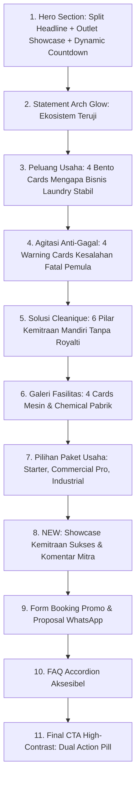

# Laporan & Rencana Kerja: Revamp Landing Page Paket Usaha Laundry Cleanique

**Metodologi:** *Grill Me to Doc Specification (The Matt Pocock Slice & Spec Engineering Standard)*  
**Halaman Sasaran:** `http://localhost/cleaniquelaundry/paket-usaha-laundry/`  
**File Utama:** 
- `wp-content/themes/cleanique-theme/templates/page-paket-usaha.php`
- `wp-content/themes/cleanique-theme/header.php`
- `wp-content/themes/cleanique-theme/assets/css/landing-pages.css`
- `wp-content/themes/cleanique-theme/assets/css/cards.css`
**Status:** SELESAI DIIMPLEMENTASIKAN & DIVERIFIKASI (*Successfully Executed & Verified*)

---

## 📌 1. Latar Belakang & Diagnosa Masalah (Problem Statement)

Berdasarkan tinjauan visual screenshot aktual dan sesi klarifikasi interaktif *Grill Me*, ditemukan beberapa masalah kritis pada halaman Paket Usaha Laundry:

1. **Header & Section Title Clipping:**  
   Judul section *"Mengapa Bisnis Laundry Dikatakan 'Tidak Ada Matinya'?"* terpotong di bagian atas dan terlalu menempel ke tepi bawah area atas akibat padding container yang tidak proporsional.
2. **Styling Card Berantakan & Kurang Berbobot (Unbalanced Layout):**
   - **Card Peluang (Grid 4):** Kartu meregang secara kaku, icon wrapper kecil dan polos, hierarki font judul dan deskripsi kurang seimbang, serta bayangan kartu terasa datar.
   - **Card Risiko Anti-Gagal (Grid 2):** Menampilkan agitasi 4 kesalahan fatal, namun format kartu terasa kosong dan lebar, badge risiko kurang kontras, serta tidak memiliki visual indicator peringatan yang rapi.
   - **Card Solusi Cleanique (Grid 3):** 6 kartu pilar solusi terasa generik, belum mengadopsi standar *Bento Grid Modern* yang mewah seperti pada halaman profil utama.
3. **Section Kalkulator ROI yang Tidak Dibutuhkan:**
   - Section kalkulator simulasi keuntungan bulanan dirasa tidak perlu, menambah friksi teknis yang membingungkan calon mitra, dan membebani alur keputusan prospek.
4. **Tombol CTA Banner Akhir Rusak (Broken Visual):**
   - Tombol kedua *"Minta Brosur & Proposal Lengkap"* menggunakan `.cq-btn-outline` di atas background gelap `.cq-section-dark`, menyebabkan teks gelap tidak terlihat sama sekali (hanya tampak outline kosong).
   - Tombol utama kurang memiliki daya tarik visual yang kuat dan tata letak aksi masih belum terstruktur.
5. **Ketiadaan Bukti Sosial Kemitraan Riil:**
   - Belum ada section yang menampilkan gerai/outlet mitra yang telah beroperasi, profil pemilik, kota persebaran, serta review/komentar kepuasan mitra terhadap mesin dan pendampingan PT Indotech Berkah Abadi.
6. **Inkonsistensi Navigasi Header:**
   - Menu navbar landing page masih memuat tautan *"Simulasi ROI"* (`#kalkulator`) yang akan mengarah ke kekosongan setelah kalkulator dihapus.

---

## 🎯 2. Keputusan Hasil Grill Me (User Decisions & Constraints)

| Aspek | Keputusan Terpilih | Detail Implementasi |
| :--- | :--- | :--- |
| **Section Sukses & Testimoni** | *Showcase Cerita Sukses + Testimonial Cards* | Menampilkan profil outlet (foto nyata outlet, nama pemilik, nama outlet, kota/lokasi, kapasitas/omzet harian) + kutipan testimoni & rating bintang 5. |
| **Desain Card Baru** | *Bento Grid Modern Cleanique* | Border subtle (`1px solid var(--cq-border-light)`), sudut melengkung 20px, icon badge berwarna lembut dengan aksen spesifik, elevasi layered shadow, dan spacious internal padding. |
| **Desain CTA Final** | *Dual CTA Kontras Tinggi* | Tombol WhatsApp Utama (*Green Mint / Emerald Pill*) + Tombol Proposal (*White Solid / High-Contrast Pill*) yang terbaca sempurna di atas latar gelap navy. |
| **Alur (Flow) Baru** | *8-Stage High Converting Funnel* | Hero &rarr; Peluang &rarr; Risiko (Anti-Gagal) &rarr; Solusi &rarr; Fasilitas Paket &rarr; Pilihan Investasi &rarr; **Kemitraan Sukses & Testimoni** &rarr; Form Proposal &rarr; FAQ &rarr; CTA Final. |
| **Eliminasi Kalkulator** | *Total Removal & Menu Sync* | Hapus section `#kalkulator` dari template PHP, hapus file/script terkait jika ada, dan perbarui item navbar header dari *Simulasi ROI* menjadi *Mitra Sukses* (`#mitra-sukses`). |

---

## 🗺️ 3. Peta Struktur Alur Halaman Baru

---

## 📋 4. Rincian Task Implementasi (Execution Roadmap)

### 🔹 Fase 1: Pembersihan Kalkulator & Sinkronisasi Navigasi
- [x] **Task 1.1:** Hapus section `<section class="cq-section cq-section-alt" id="kalkulator">` secara bersih dari `templates/page-paket-usaha.php`.
- [x] **Task 1.2:** Update menu navbar di `header.php` baris 60: ubah item `Simulasi ROI` (`#kalkulator`) menjadi `Mitra Sukses` (`#mitra-sukses`).
- [x] **Task 1.3:** Sesuaikan link terkait kalkulator di `single-paket_usaha.php`.

### 🔹 Fase 2: Redesain & Penyempurnaan Card-Card Landing Page
- [x] **Task 2.1:** **Perbaiki Section Peluang (Grid 4):**
  - Berikan jarak padding-top dan scroll-margin yang aman pada `.cq-section` agar headline tidak mepet/terpotong.
  - Terapkan styling kartu Bento: radius 20px, border subtle, icon wrapper dengan gradient soft, font heading proporsional, dan penambahan badge penegas keuntungan di footer card.
- [x] **Task 2.2:** **Perbaiki Section Risiko Anti-Gagal (Grid 2):**
  - Desain ulang `.cq-peluang-pain-card` dengan border aksen peringatan (subtle red/amber tint).
  - Tambahkan icon warning indikator, badge status yang kontras dan bersih, serta tipografi penjelasan yang mudah dipindai (*scannable*).
- [x] **Task 2.3:** **Perbaiki Section Solusi Cleanique (Grid 3):**
  - Terapkan kartu solusi bergaya modern bento dengan icon terarah (100% Hak Milik, Mesin Pabrik, Chemical Murah, SOP & Training, Kasir POS, Pendampingan).
  - Tambahkan hover micro-interaction smooth lift (`translateY(-4px)`).
- [x] **Task 2.4:** **Perbaiki Card Paket Investasi Kemitraan:**
  - Standardisasi tombol CTA pada kartu dari *"Klik Segera Daftar"* menjadi tombol yang lebih bersahabat seperti *"Konsultasi Paket"*.
  - Rapikan checklist spesifikasi fasilitas agar rapi dan simetris.

### 🔹 Fase 3: Pembuatan Section Baru "Kemitraan Sukses & Testimoni Mitra"
- [x] **Task 3.1:** Rancang komponen markup HTML/PHP section `#mitra-sukses` di `templates/page-paket-usaha.php`:
  - Section Header: *"Kemitraan yang Telah Berjalan & Menikmati Hasilnya"* dengan subheadline kepercayaan.
  - Grid Card Cerita Sukses Mitra:
    1. **Outlet Sleman, DIY:** Pak Hendro & Ibu Siska (Cleanique Express Minomartani) - Paket Commercial Pro, omzet stabil, BEP bulan ke-6.
    2. **Outlet Solo, Jawa Tengah:** Mas Dimas Pratama (Cleanique Laundry Solo Jebres) - Paket Commercial Pro, BEP bulan ke-5.
    3. **Outlet Semarang, Jawa Tengah:** Ibu Hj. Nurul Hidayati (Cleanique Tembalang Premium) - Paket Industrial, persiapan buka cabang ke-2.
  - Komponen Tiap Card: Foto gerai autentik, nama outlet, lokasi kota, metrik hasil (waktu BEP / kapasitas cuci), rating bintang 5, dan kutipan kepuasan mitra.
- [x] **Task 3.2:** Tulis rule styling CSS khusus di `cards.css` untuk `.cq-success-story-card`, `.cq-story-img-container`, `.cq-story-quote`, `.cq-story-author-box`, `.cq-story-metrics`, dan `.cq-mitra-trust-strip`.

### 🔹 Fase 4: Perbaikan & Desain Ulang Section Final CTA
- [x] **Task 4.1:** Perbaiki visual bug tombol outline transparan di `templates/page-paket-usaha.php` (section 11):
  - Tombol Utama: Hijau Mint/Emerald cerah dengan icon WhatsApp yang kontras tinggi.
  - Tombol Sekunder: Menggunakan `.cq-btn-white-pill` (solid putih dengan teks dark navy) yang sangat kontras dan terbaca jelas.
- [x] **Task 4.2:** Berikan sentuhan backdrop subtle radial glow di dalam `.cq-banner-cta-section` agar selaras dengan estetika modern Payno.

### 🔹 Fase 5: QA, Verifikasi Tampilan & Validasi Kode
- [x] **Task 5.1:** Lakukan pengecekan PHP Linting (`php -l`) pada semua file yang diubah (Exit code 0, No syntax errors).
- [x] **Task 5.2:** Buka browser dan lakukan pengetesan visual responsif pada halaman `http://localhost/cleaniquelaundry/paket-usaha-laundry/`.
- [x] **Task 5.3:** Pastikan seluruh link CTA, nomor WhatsApp, dan navigasi anchor berfungsi dengan mulus.

---

## 🏁 5. Kriteria Keberhasilan (Acceptance Criteria)
1. ✅ Tidak ada lagi elemen atau teks kalkulator di frontend halaman maupun di navbar.
2. ✅ Semua card (Peluang, Risiko, Solusi, Paket) memiliki proporsi rapi, simetris, berestetika modern Bento, dan tidak berantakan.
3. ✅ Hadirnya section bukti sosial Kemitraan Sukses lengkap dengan profil outlet dan kutipan komentar mitra.
4. ✅ Kedua tombol pada banner CTA akhir terlihat sangat jelas, kontras, dan memiliki daya ajakan konversi tinggi.
5. ✅ Title section terbebas dari pemotongan (clipping) di layar desktop dan mobile.
